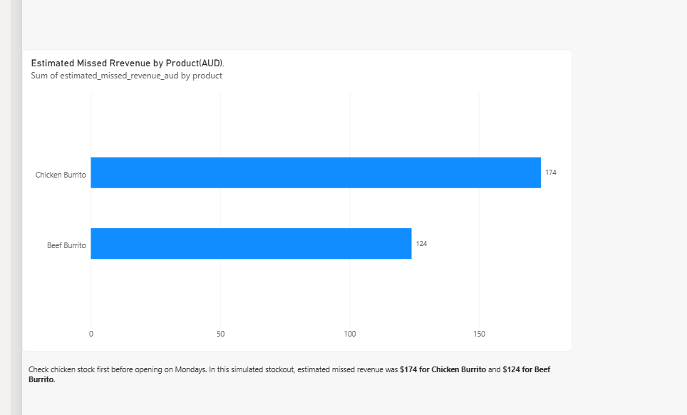

# Hidden Demand: When Low Sales Signal an Empty Shelf

## Business question

What revenue could a restaurant lose when a product is unavailable, and which item should the team verify first before opening?

## Data and method

I relied on 32 simulated daily sales records covering two burrito products. I verified the calculations in Excel, rebuilt them in PostgreSQL, and visualised the results in Power BI.

For every full-day stockout, I estimated expected sales using the average of three earlier in-stock days for the same product and weekday. I subtracted the actual units sold and multiplied the difference by the unit price.

## Findings

| Product | Estimated missed units | Estimated missed revenue (AUD) |
|---|---:|---:|
| Chicken Burrito | 12 | $174 |
| Beef Burrito | 8 | $124 |

The Chicken Burrito accounted for $50 more in estimated missed revenue. Drawing on this example, I would verify chicken stock first before opening on Mondays and monitor stockouts across the next four Mondays.

## Dashboard

## Limitations

The data is simulated, and each estimate draws on only three comparison days. The analysis addresses full-day stockouts. Purchases of substitute items by customers might lessen the overall impact on revenue.

## Reproduce the analysis

Load [the sales CSV](hidden_demand_sales.csv) into PostgreSQL as `public.hidden_demand_sales_clean`, then execute [the analysis query](hidden_demand_analysis.sql).
